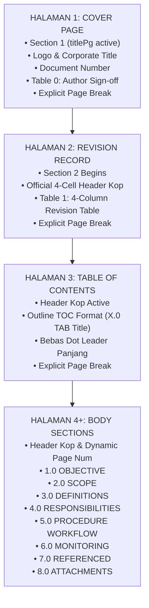

# PANDUAN RESMI FORMATTING, STYLING, DAN VALIDASI DOKUMEN SISTEM MANAJEMEN TERINTEGRASI (IMS / CSMS)
## PT NIRWANA BHUMI ENERGY

**Dokumen Referensi Teknis & Standar Baku Mutu Dokumen**  
**Klasifikasi:** Standar Desain, OpenXML Architecture, & Quality Assurance (QA)  
**Versi:** 3.0 (October 2026)  
**Target File:** Standard Operating Procedures (SOP) & Standalone Forms  

---

## DAFTAR ISI
1. [Pendahuluan & Ruang Lingkup Standar](#1-pendahuluan--ruang-lingkup-standar)
2. [Geometri Halaman & Arsitektur Dokumen](#2-geometri-halaman--arsitektur-dokumen)
3. [Standar Tipografi, Hierarki Teks, & Palet Warna](#3-standar-tipografi-hierarki-teks--palet-warna)
4. [Pemosisian & Indentasi Presisi (Headings, Body, & Bullet Lists)](#4-pemosisian--indentasi-presisi-headings-body--bullet-lists)
5. [Arsitektur Halaman Muka (Cover Page - Page 1) & Aturan Zero-Overflow](#5-arsitektur-halaman-muka-cover-page---page-1--aturan-zero-overflow)
6. [Struktur Paginasi 4 Halaman Awal SOP](#6-struktur-paginasi-4-halaman-awal-sop)
7. [Standar Desain & Rekayasa Tabel](#7-standar-desain--rekayasa-tabel)
8. [Header & Footer Section-Specific](#8-header--footer-section-specific)
9. [Standar Formulir Mandiri (Standalone Forms)](#9-standar-formulir-mandiri-standalone-forms)
10. [Spesifikasi Teknis OpenXML & Pustaka Helper Python](#10-spesifikasi-teknis-openxml--pustaka-helper-python)
11. [Engine Audit Otomatis (AST / XML Inspection Script)](#11-engine-audit-otomatis-ast--xml-inspection-script)
12. [Toolchain Verifikasi Visual & Koordinat Sub-Pixel (Word COM + PyMuPDF)](#12-toolchain-verifikasi-visual--koordinat-sub-pixel-word-com--pymupdf)
13. [Protokol Validasi Bertahap & Matriks Kriteria Kelulusan (Pass/Fail)](#13-protokol-validasi-bertahap--matriks-kriteria-kelulusan-passfail)

---

## 1. PENDAHULUAN & RUANG LINGKUP STANDAR

Dokumen ini disusun sebagai **Single Source of Truth (SSOT)** dan pedoman absolut bagi pembuatan, transformasi, maupun audit berkas dokumen Sistem Manajemen Terintegrasi (IMS / CSMS) di lingkungan PT Nirwana Bhumi Energy.

### 1.1 Tujuan
1. Menjamin konsistensi visual dan struktural 100% pada seluruh dokumen SOP (Standar Operasional Prosedur) dan Formulir (Forms) berstandar internasional (ISO 9001, ISO 14001, ISO 45001, Contractor Safety Management System / CSMS SKK Migas & PLN).
2. Menghilangkan seluruh anomali formatting yang lazim terjadi pada otomasi dokumen Word, seperti:
   - Tumpahnya blok otorisasi cover ke halaman kedua (*page spill / overflow*).
   - Ketidaksejajaran (*misalignment*) antara nomor heading, judul, dan huruf pertama paragraf body.
   - Poin peluru (*bullet points*) yang terlalu menjorok ke kanan atau menggunakan karakter manual yang merusak *hanging indent*.
   - Tabel yang terpotong canggung (*awkward row break*) antar halaman atau teks tabel yang menempel ke atas (*top-heavy*).
3. Memberikan panduan teknis hingga ke tingkat representasi unit Word (dxa/twips, point, centimeter) dan skema OpenXML (`w:numPr`, `w:ind`, `w:vAlign`, `w:tcMar`).

---

## 2. GEOMETRI HALAMAN & ARSITEKTUR DOKUMEN

Seluruh dokumen resmi PT Nirwana Bhumi Energy wajib mengacu pada spesifikasi fisik kertas dan margin berikut:

### 2.1 Spesifikasi Kertas
- **Ukuran Kertas:** A4 Standard International (`210 mm x 297 mm` / `8.27 inci x 11.69 inci`).
- **Dimensi OpenXML (twips/dxa):**
  - Lebar (`w:w`): `11906 dxa` (setara 8.268 inci / 595.3 pt).
  - Tinggi (`w:h`): `16838 dxa` (setara 11.693 inci / 841.9 pt).
- **Orientasi:** Portrait (`<w:pgSz w:w="11906" w:h="16838" w:orient="portrait"/>`).

### 2.2 Margin Halaman Dokumen SOP
Dokumen SOP menggunakan margin presisi untuk mengakomodasi penjilidan (*binding gutter*) di sisi kiri:

| Sisi Margin | Nilai Metrik | Nilai Inci | Nilai Points (pt) | Nilai OpenXML (dxa / twips) |
| :--- | :--- | :--- | :--- | :--- |
| **Kiri (Left)** | **2.20 cm** | **0.866 in** | **62.42 pt** | **1247 dxa** |
| **Kanan (Right)** | **2.00 cm** | **0.787 in** | **56.70 pt** | **1134 dxa** |
| **Atas (Top)** | **2.00 cm** | **0.787 in** | **56.70 pt** | **1134 dxa** |
| **Bawah (Bottom)** | **2.00 cm** | **0.787 in** | **56.70 pt** | **1134 dxa** |
| **Header Distance** | 1.25 cm | 0.492 in | 35.43 pt | 708 dxa |
| **Footer Distance** | 1.25 cm | 0.492 in | 35.43 pt | 708 dxa |

### 2.3 Margin Formulir Mandiri (Standalone Forms)
Untuk formulir isian lapangan yang memerlukan ruang kisi maksimal:
- **Left Margin:** `0.8 inci` (`2.03 cm` / `1152 dxa` / `57.6 pt`).
- **Right Margin:** `0.8 inci` (`2.03 cm` / `1152 dxa` / `57.6 pt`).
- **Top Margin:** `0.6 inci` (`1.52 cm` / `864 dxa` / `43.2 pt`).
- **Bottom Margin:** `0.6 inci` (`1.52 cm` / `864 dxa` / `43.2 pt`).

### 2.4 Pembagian Section (Section Breaks)
Dokumen SOP memiliki konfigurasi section yang ketat:
- **Section 1 (Cover Page):**
  - Mengaktifkan `<w:titlePg/>` (`different_first_page_header_footer = True`).
  - Tidak menampilkan Header Tabel maupun Footer standar.
  - Berisi judul, logo, nomor dokumen, dan Tabel 0 (Otorisasi).
  - Diakhiri dengan **Explicit Page Break** (`<w:br w:type="page"/>`).
- **Section 2 (Body & Prosedur):**
  - Header aktif menampilkan tabel kop resmi 4 sel berbingkai tipis.
  - Footer aktif menampilkan nomor halaman dinamis (`Page X of Y`).

---

## 3. STANDAR TIPOGRAFI, HIERARKI TEKS, & PALET WARNA

Tipografi dokumen IMS PT Nirwana Bhumi Energy menggunakan keluarga huruf **Arial** tunggal untuk seluruh komponen.

### 3.1 Hierarki Ukuran & Bobot Huruf

| Elemen Dokumen | Font Family | Ukuran (pt) | Bobot (Weight) | Warna (Hex / RGB) | Line Spacing | Space Before | Space After | Perataan (Alignment) |
| :--- | :--- | :--- | :--- | :--- | :--- | :--- | :--- | :--- |
| **Cover: Nama PT** | Arial | 20.0 pt | Bold | `#000000` (Black) | 1.15 | 0 pt | 6 pt | Center |
| **Cover: Judul SOP** | Arial | 18.0 pt | Bold | `#000000` (Black) | 1.15 | 6 pt | 6 pt | Center |
| **Cover: Metadata** | Arial | 12.0 pt | Bold | `#000000` (Black) | 1.15 | 0 pt | 4 pt | Center |
| **Cover: Author Block** | Arial | 10.0 pt | Bold/Reg | `#000000` (Black) | 1.05 | 0 pt | 2 pt | Left |
| **Heading 1 (1.0, 2.0)** | Arial | 13.0 pt | Bold | `#000000` (Black) | 1.15 | 12 pt | 4 pt | Left (w/ Tab) |
| **Subheading (1.1, 1.2)** | Arial | 11.0 pt | Bold | `#000000` (Black) | 1.15 | 8 pt | 3 pt | Left |
| **Body Paragraph** | Arial | 10.5 pt | Regular | `#3B3838` (Charcoal) | 1.15 | 0 pt | 4 pt | Justify |
| **Bullet List Text** | Arial | 10.5 pt | Regular | `#3B3838` (Charcoal) | 1.15 | 0 pt | 2 pt | Justify |
| **Table Header Row** | Arial | 9.5 pt | Bold | `#000000` (Black) | 1.00 | 0 pt | 0 pt | Center / Left |
| **Table Data Rows** | Arial | 9.0 pt | Regular | `#000000` / `#3B3838` | 1.05 | 0 pt | 0 pt | Left / Center |
| **Header Kop (Title)** | Arial | 11.0 pt | Bold | `#000000` (Black) | 1.00 | 0 pt | 0 pt | Center |
| **Header Kop (Meta)** | Arial | 8.0 pt | Bold/Reg | `#000000` (Black) | 1.00 | 0 pt | 0 pt | Left |
| **Footer Document** | Arial | 8.5 pt | Regular | `#595959` (Gray) | 1.00 | 2 pt | 0 pt | Left & Right |

### 3.2 Palet Warna Resmi
Gunakan kode hex eksak berikut pada styling Word:
- **Heading & Primary Text:** `#000000` (Black murni - `RGB(0, 0, 0)`).
- **Body & Bullet Text:** `#3B3838` (Dark Charcoal - `RGB(59, 56, 56)`). Teks ini memberikan keterbacaan tinggi tanpa kekerasan kontras warna hitam pekat.
- **Table Header Fill:** `#D9E1F2` (Soft Periwinkle / Navy Accent Tint).
- **Table Alternating Fill (Zebra Even):** `#F9FBFD` (Ultra-light tint untuk pembeda baris).
- **Table Alternating Fill (Zebra Odd):** `#FFFFFF` (Putih bersih).
- **Form Section Accent:** `#003366` (Navy Blue Korporat - `RGB(0, 51, 102)`).
- **Border Lines:** `#BFBFBF` (Light Gray - `0.5 pt` tebal / `w:sz="4"`).

---

## 4. PEMOSISIAN & INDENTASI PRESISI (HEADINGS, BODY, & BULLET LISTS)

Bagian ini mengatur aturan penyelarasan lurus vertikal (*vertical alignment collinearity*) yang diuji pada sub-pixel render.

### 4.1 Prinsip Kolinier 0.5 Inci (The 0.5" Collinear Rule)
Dalam sistem penomoran SOP:
1. **Nomor Bagian Utama (`1.0`, `2.0`, dst.)** menempel pada margin kiri (`x = 62.42 pt` / `0 cm` dari margin).
2. **Karakter Tab Stop** diposisikan tepat di **`0.5 inci`** (`720 dxa` / `36.0 pt` dari margin kiri $\rightarrow$ koordinat absolut halaman: `62.42 + 36.0 = 98.42 pt`).
3. **Huruf Pertama Judul Heading** (misalnya huruf `O` pada `OBJECTIVE`) dimulai pada koordinat **`98.42 pt`**.
4. **Huruf Pertama Paragraf Body** wajib diberi indentasi kiri (`left_indent = Inches(0.5)`) sehingga tepat berada pada koordinat **`98.42 pt`** (sejajar lurus vertikal di bawah huruf `O`).
5. **Simbol Poin Peluru (Bullet Dot `•`)** diposisikan sejajar pada koordinat **`98.42 pt - 101.06 pt`**.
6. **Teks Gantung Bullet (Hanging Text)** bergeser ke **`1134 dxa`** (`0.7875 inci` / `119.06 pt` absolut).

```
Margin Kiri Dokumen (x = 62.42 pt)
|
|   Tab Stop (0.5" / +36.0 pt -> x = 98.42 pt)
|   |
v   v
1.0 OBJECTIVE
    |
    |-- Paragraf Body (left_indent = 0.5" -> x = 98.42 pt)
    |   The purpose of this procedure is to define the minimum safety
    |   requirements and responsibilities...
    |
    |-- Native Bullet List (numId=2, ilvl=0, w:ind left="1134")
    |   •   Ensure full compliance with statutory regulations and CSMS.
    |   ^   ^
    |   |   +-- Teks Bullet (Hanging Text -> x = 119.06 pt)
    |   +------ Titik Bullet Dot (•) sejajar huruf 'O' & 'T' (x = 98.42 pt)
```

### 4.2 Matriks Koordinat Sub-Pixel & Toleransi Bounding Box

| Elemen Teks | Margin Offset | Koordinat PyMuPDF X0 (pt) | Toleransi X0 | Status Kepatuhan |
| :--- | :--- | :--- | :--- | :--- |
| **Heading Prefix (`1.0\t`)** | `0.000 in` (`0 dxa`) | `62.42 pt` | $\pm 0.5 \text{ pt}$ | Flush dengan Margin Kiri |
| **Heading Text (`OBJECTIVE`)** | `0.500 in` (`720 dxa`) | `98.42 pt` | $\pm 1.0 \text{ pt}$ | Tepat pada Tab Stop 0.5" |
| **Body Paragraph** | `0.500 in` (`720 dxa`) | `98.42 pt` | $\pm 1.0 \text{ pt}$ | Sejajar lurus dengan Heading |
| **Bullet Dot (`•`)** | `0.500 in` (`720 dxa`) | `98.42 - 101.06 pt` | $\pm 2.0 \text{ pt}$ | Flush vertikal di bawah Body |
| **Bullet Hanging Text** | `0.7875 in` (`1134 dxa`) | `119.06 pt` | $\pm 1.5 \text{ pt}$ | Indentasi gantung teratur |

### 4.3 Kesalahan Fatal yang Harus Dihindari
- **DILARANG** menambahkan karakter manual `•\t` atau `- ` ke dalam run teks paragraf yang telah memiliki indentasi. Hal ini akan menyebabkan titik peluru terdorong ke posisi `119.06 pt` dan teks terlempar ke `139.70 pt`.
- **DILARANG** membiarkan paragraf body berada di `left_indent = 0.0`. Hal ini merusak hierarki outline dokumen di mana body berada di bawah nomor heading.

---

## 5. ARSITEKTUR HALAMAN MUKA (COVER PAGE - PAGE 1) & ATURAN ZERO-OVERFLOW

Cover page merupakan representasi formal dokumen yang diaudit oleh pihak auditor pihak ketiga (SKK Migas, Pertamina, PLN). Halaman 1 **wajib 100% tuntas dalam satu halaman tunggal**.

### 5.1 Hierarki Komponen Cover Page
1. **Bagian Atas:**
   - Spasi atas: 4 paragraf kosong terukur (`Pt(12)`).
   - Logo Perusahaan: Berada di tengah (*Centered*), gambar `logo_nbe.png` dengan lebar `1.85 inci` (`4.7 cm`).
   - Jeda spasi: 2 paragraf kosong.
2. **Bagian Tengah:**
   - Nama Perusahaan: `PT NIRWANA BHUMI ENERGY` (Arial `20.0 pt Bold`, Centered, `#000000`).
   - Jenis Dokumen: `STANDARD OPERATING PROCEDURE` (Arial `13.0 pt Bold`, Centered, `#000000`).
   - Judul Dokumen: `[JUDUL SPESIFIK PROSEDUR]` (Arial `18.0 pt Bold`, Centered, `#000000`).
   - Garis Pemisah / Nomor Dokumen: `Document No: XXXX-SOP-XXX-XXX-2026` (Arial `12.0 pt Bold`, Centered).
   - Jeda spasi proporsional: 3 paragraf kosong.
3. **Bagian Bawah (Tabel Otorisasi / Table 0):**
   - Berada di kuadran bawah Halaman 1.
   - Diikuti langsung oleh **Explicit Page Break**.

### 5.2 Spesifikasi Baku Tabel Otorisasi (Table 0)
Tabel 0 dibangun dengan parameter bebas bingkai luar (*borderless*):
- **Jumlah Baris x Kolom:** Tepat 3 Baris x 2 Kolom.
- **Dimensi Lebar Sel:**
  - **Kolom 0 (Label Jabatan):** `900430 dxa` (~1.57 inci). Teks: `Approved By`, `Verified By`, `Created By`. Font: Arial `10.0 pt Bold`.
  - **Kolom 1 (Data Pejabat & Peran):** `2160270 dxa` (~3.77 inci). Font: Arial `10.0 pt Regular`.
- **Perataan Vertikal:** Wajib 100% Center (`<w:vAlign w:val="center"/>`).
- **Aturan Pembungkusan Teks Jabatan (Text Wrapping):**
  Untuk mencegah sel melebar ke bawah yang dapat mendorong Page Break ke Halaman 2, nama dan peran dipecah secara manual menjadi 2 baris terindentasi:
  ```text
  Baris 0:
  Col 0: Approved By
  Col 1: :  Bima Satryo Hartanto
            (President Director / CEO)

  Baris 1:
  Col 0: Verified By
  Col 1: :  Dennis Raditya
            (Director of Operations & Technology / CTO)

  Baris 2:
  Col 0: Created By
  Col 1: :  Abdul Qodir Al Jailani
            (Commissioner / IMS Team Lead)
  ```
- **Keseragaman Nama Entitas:** Wajib menggunakan nama resmi: `PT Nirwana Bhumi Energy`.

---

## 6. STRUKTUR PAGINASI 4 HALAMAN AWAL SOP

Setiap dokumen SOP memiliki struktur 4 halaman muka yang mutlak seragam:



### 6.1 Rincian Halaman 2: Riwayat Revisi (Revision Record)
- **Tabel Riwayat Revisi (Table 1):**
  - Kolom 0: `Rev` (Lebar `10%`, Centered). Nilai: `0`.
  - Kolom 1: `Date` (Lebar `20%`, Centered). Nilai: `October 2026`.
  - Kolom 2: `Description of Changes` (Lebar `50%`, Left). Nilai: `Initial Issue - Standard CSMS Procedure for PT Nirwana Bhumi Energy (XXXX-SOP-...)`.
  - Kolom 3: `Prepared / Approved` (Lebar `20%`, Left). Nilai: `IMS & HSE Team`.
  - Header tabel berwarna `#D9E1F2`, Arial `9.5 pt Bold`.
  - Diakhiri dengan **Page Break**.

### 6.2 Rincian Halaman 3: Daftar Isi (Table of Contents)
- Menggunakan gaya **Outline Clean Tab Stop**:
  - Teks: `1.0\tOBJECTIVE`
  - Teks: `2.0\tSCOPE`
  - Teks: `3.0\tDEFINITIONS & ABBREVIATIONS`
  - Teks: `4.0\tRESPONSIBILITIES`
  - Teks: `5.0\tPROCEDURE STEPS`
  - Teks: `6.0\tPERFORMANCE INDICATORS & AUDIT`
  - Teks: `7.0\tREFERENCED DOCUMENTS`
  - Teks: `8.0\tATTACHMENTS & ASSOCIATED FORMS`
- **Aturan Tipografi:** Arial `10.5 pt`, Regular, Spasi Sebelum `0 pt`, Spasi Sesudah `2 pt`, Line Spacing `1.15`.
- **DILARANG** menggunakan titik-titik panjang manual (`..........`) yang tidak terikat tab stop Word karena akan berantakan pada sistem pembaca Word yang berbeda resolusi.
- Diakhiri dengan **Page Break**.

---

## 7. STANDAR DESAIN & REKAYASA TABEL

Tabel dalam prosedur dan formulir wajib mematuhi rekayasa OpenXML agar dapat dibaca dengan nyaman dan tidak terpotong canggung saat dicetak.

### 7.1 Gaya dan Perataan Tabel
- **Gaya Dasar:** `Table Grid`.
- **Alignment Tabel Terhadap Halaman:** Center (`WD_TABLE_ALIGNMENT.CENTER`).
- **Garis Batas (Borders):** Garis tipis solid warna abu-abu netral (`#BFBFBF`, tebal `0.5 pt` / `w:sz="4"`).

### 7.2 Header Baris (Row 0)
- **Background Fill:** `#D9E1F2` (Soft Periwinkle).
- **Tipografi:** Arial `9.5 pt Bold`, warna `#000000`.
- **Perataan Horizontal:**
  - Center untuk kolom penomoran, kode, status, dan tanggal.
  - Left untuk kolom uraian, aktivitas, atau nama tanggung jawab.
- **Perataan Vertikal:** Wajib 100% Center (`w:vAlign w:val="center"`).
- **Cell Margins (Padding):** Top `100 dxa`, Bottom `100 dxa`, Left `120 dxa`, Right `120 dxa`.

### 7.3 Baris Isi Data (Data Rows)
- **Zebra Striping (Belang-Belang Lembut):**
  - Baris Ganjil (Row 1, 3, 5...): Background `#F9FBFD`.
  - Baris Genap (Row 2, 4, 6...): Background `#FFFFFF`.
- **Tipografi:** Arial `9.0 pt` (atau `8.5 pt` untuk tabel matriks padat), Regular, warna `#000000`.
- **Perataan Horizontal Teks:** Wajib **Rata Kiri (`WD_ALIGN_PARAGRAPH.LEFT`)** untuk seluruh teks kalimat atau penjelasan. Hanya nomor urut (`1, 2, 3`) atau simbol ceklis (`[  ]`, `OK`, `N/A`) yang diperbolehkan rata tengah.
- **Perataan Vertikal:** Wajib 100% **Center (`w:vAlign w:val="center"`)**. Tidak boleh teks menempel pada garis atas sel (*top-heavy*).
- **Cell Margins (Padding):** Top `80 dxa` (~4 pt), Bottom `80 dxa` (~4 pt), Left `120 dxa` (~6 pt), Right `120 dxa` (~6 pt).

### 7.4 Aturan Anti-Pecah Sel (Table Row cantSplit)
Setiap baris data tabel wajib menyertakan tag `<w:cantSplit/>` pada `w:trPr` sehingga Word tidak membelah baris di tengah-tengah kalimat ketika berada di ujung halaman:
```xml
<w:trPr>
    <w:cantSplit/>
</w:trPr>
```

---

## 8. HEADER & FOOTER SECTION-SPECIFIC

### 8.1 Header Dokumen Prosedur (Section 2)
Header Prosedur berupa tabel kop resmi 4 sel berbingkai tipis dengan struktur:

```
+----------------+------------------------------------------------+
|                |         PT NIRWANA BHUMI ENERGY                |
|  [LOGO NBE]    |  STANDARD OPERATING PROCEDURE: [JUDUL SOP]     |
|   (0.9 in)     +--------------------+----------------+----------+
|                | Revision: 0        | Number: XXX... | Rev: -   |
+----------------+--------------------+----------------+----------+
```
- **Sel 0 (Logo):** Kolom kiri berisi gambar logo resmi berukuran `0.9 inci`.
- **Sel 1 (Title):** Berisi nama PT (`Arial 9.0 pt Bold`) dan Judul Prosedur (`Arial 11.0 pt Bold`).
- **Sel 2-4 (Metadata):** Berisi Status Revisi, Nomor Dokumen terdaftar, dan Tanggal Efektif (`Arial 8.0 pt`).

### 8.2 Footer Dokumen Prosedur (Section 2)
Footer mencantumkan identitas kepemilikan dan penomoran dinamis:
- **Teks Kiri:** `PT Nirwana Bhumi Energy - Integrated Management System` (Arial `8.5 pt`, Regular, `#595959`).
- **Teks Kanan:** `Page X of Y` menggunakan Field Code native Word (`PAGE` dan `NUMPAGES`).
- **Top Border Garis Tipis:** Diberi garis pembatas atas tipis (`0.5 pt`, `#D3D3D3`) memisahkan margin bawah teks body dengan footer.

---

## 9. STANDAR FORMULIR MANDIRI (STANDALONE FORMS)

Formulir mandiri didesain agar siap cetak (*publication-ready*) sebagai lembar kerja inspeksi dan pencatatan lapangan.

### 9.1 Kop Formulir (Form Header Table)
Terdiri atas tabel 2 baris x 3 kolom:
- **Baris 0, Kolom 0:** Kotak Identitas PT NBE (`#F2F5F8`, Arial `9.0 pt Bold`, Navy Blue `#003366`).
- **Baris 0, Kolom 1:** Judul Formulir dalam Huruf Kapital Penuh (`#D9E1F2`, Arial `10.0 pt Bold`, Black `#000000`).
- **Baris 0, Kolom 2:** Metadata No Formulir, Revisi, dan Tanggal Efektif (`#F2F5F8`, Arial `8.5 pt Regular`).
- **Baris 1 (Merged Col 0-2):** Kotak Acuan SOP Prosedur Terkait (`#EAECEF`, Arial `8.5 pt Italic` - *Standard Operational Reference: XXXX-SOP-...*).

### 9.2 Kotak Metadata Lapangan (Metadata Grid Box)
Tabel 4 kolom yang mencatat konteks pelaksanaan inspeksi:
- Baris 1: `Project / Rig Site` & `Date of Inspection`
- Baris 2: `Location / Facility` & `Work Permit No.`
- Baris 3: `Supervisor in Charge` & `Contractor / Dept`
- Kolom label menggunakan background `#F2F5F8` Arial `9.0 pt Bold`. Kolom nilai menggunakan background `#FFFFFF` Arial `9.0 pt Regular`.

### 9.3 Blok Otorisasi Akhir (Form Sign-off Block)
Setiap formulir wajib ditutup dengan tabel otorisasi 3 pilar:
- **Pilar 1:** `Prepared By / Field Inspector`
- **Pilar 2:** `Reviewed By / Technical Authority` (`Dennis Raditya - Director of Operations & Technology`)
- **Pilar 3:** `Approved By / Executive Authority` (`Bima Satryo Hartanto - President Director / CEO`)
- Kolom tanda tangan memiliki tinggi minimum `150 dxa` untuk pembubuhan tanda tangan basah atau stempel digital.

---

## 10. SPESIFIKASI TEKNIS OPENXML & PUSTAKA HELPER PYTHON

Berikut adalah implementasi Python menggunakan `python-docx` dan pustaka `docx.oxml` yang digunakan untuk menjamin 100% kepatuhan OpenXML:

```python
"""
Pustaka Inti Helper OpenXML Dokumen IMS PT Nirwana Bhumi Energy
File: csms_v3_core.py
"""
import docx
from docx.shared import Inches, Pt, RGBColor
from docx.enum.text import WD_ALIGN_PARAGRAPH
from docx.enum.table import WD_TABLE_ALIGNMENT
from docx.oxml import OxmlElement, parse_xml
from docx.oxml.ns import nsdecls, qn

def set_cell_margins(cell, top=80, bottom=80, left=120, right=120):
    """
    Mengatur padding internal sel tabel (dalam satuan dxa / twips).
    Default: 80 dxa (~4 pt) top/bottom, 120 dxa (~6 pt) left/right.
    """
    tcPr = cell._tc.get_or_add_tcPr()
    tcMar = OxmlElement('w:tcMar')
    for m, val in [('w:top', top), ('w:bottom', bottom), ('w:left', left), ('w:right', right)]:
        node = OxmlElement(m)
        node.set(qn('w:w'), str(val))
        node.set(qn('w:type'), 'dxa')
        tcMar.append(node)
    tcPr.append(tcMar)

def set_cell_shading(cell, color_hex):
    """
    Mengatur warna latar belakang (shading) sel tabel.
    Contoh: color_hex = 'D9E1F2' atau 'F9FBFD'.
    """
    tcPr = cell._tc.get_or_add_tcPr()
    shd = parse_xml(f'<w:shd {nsdecls("w")} w:fill="{color_hex}"/>')
    tcPr.append(shd)

def set_cell_vcenter(cell):
    """
    Memaksa perataan teks di dalam sel tabel tepat di tengah secara vertikal.
    Mencegah teks menempel ke tepi atas border.
    """
    tcPr = cell._tc.get_or_add_tcPr()
    for v in tcPr.xpath('w:vAlign'):
        tcPr.remove(v)
    vAlign = OxmlElement('w:vAlign')
    vAlign.set(qn('w:val'), 'center')
    tcPr.append(vAlign)

def set_row_cant_split(row):
    """
    Mencegah baris tabel terbelah canggung saat berada di perbatasan halaman.
    """
    trPr = row._tr.get_or_add_trPr()
    cantSplit = OxmlElement('w:cantSplit')
    trPr.append(cantSplit)

def style_run(run, font_name="Arial", size_pt=10.5, bold=False, italic=False, color_rgb=(0x3B, 0x38, 0x38)):
    """
    Menerapkan tipografi lengkap pada run teks Word.
    """
    run.font.name = font_name
    run.font.size = Pt(size_pt)
    run.bold = bold
    run.italic = italic
    if color_rgb:
        run.font.color.rgb = RGBColor(*color_rgb)

def add_native_bullet_paragraph(doc, text, num_id=2, ilvl=0, left_dxa=1134):
    """
    Membangun paragraf daftar peluru native Word yang selaras sempurna
    dengan hierarki heading dan body text.
    """
    p = doc.add_paragraph(style='List Paragraph')
    p.alignment = WD_ALIGN_PARAGRAPH.JUSTIFY
    p.paragraph_format.space_before = Pt(0)
    p.paragraph_format.space_after = Pt(2)
    p.paragraph_format.line_spacing = 1.15

    # Susun XML w:numPr
    pPr = p._p.get_or_add_pPr()
    numPr = OxmlElement('w:numPr')
    ilvl_el = OxmlElement('w:ilvl')
    ilvl_el.set(qn('w:val'), str(ilvl))
    numId_el = OxmlElement('w:numId')
    numId_el.set(qn('w:val'), str(num_id))
    numPr.append(ilvl_el)
    numPr.append(numId_el)
    pPr.append(numPr)

    # Susun XML w:ind untuk hanging indent presisi
    ind = OxmlElement('w:ind')
    ind.set(qn('w:left'), str(left_dxa))
    pPr.append(ind)

    # Tambahkan teks
    r = p.add_run(text)
    style_run(r, font_name="Arial", size_pt=10.5, color_rgb=(0x3B, 0x38, 0x38))
    return p
```

---

## 11. ENGINE AUDIT OTOMATIS (AST / XML INSPECTION SCRIPT)

Skrip Python mandiri berikut (`audit_v3_docs.py`) melakukan verifikasi integritas struktur file `.docx` secara menyeluruh tanpa perlu membuka Microsoft Word:

```python
"""
Engine Audit Otomatis Integritas Dokumen IMS PT NBE
File: audit_v3_docs.py
"""
import os, glob
import docx
from docx.enum.text import WD_ALIGN_PARAGRAPH

V3_DIR = "CSMS PROCEDURES PT NBE V3"

def run_document_audit():
    files = glob.glob(f"{V3_DIR}/**/*.docx", recursive=True)
    print("=" * 65)
    print(f"AUDIT INTEGRITAS DOKUMEN: Total {len(files)} berkas terdeteksi")
    print("=" * 65)

    errors = []
    sop_count = 0
    form_count = 0

    for f in sorted(files):
        rel_path = os.path.relpath(f, V3_DIR)
        sz = os.path.getsize(f)
        if sz == 0:
            errors.append(f"{rel_path}: Berkas 0 bytes / korup!")
            continue

        try:
            doc = docx.Document(f)
        except Exception as e:
            errors.append(f"{rel_path}: Gagal membuka docx: {e}")
            continue

        p_cnt = len(doc.paragraphs)
        t_cnt = len(doc.tables)

        # 1. Pengecekan Kontaminasi Teks Asing / Placeholder
        full_text = " ".join([p.text for p in doc.paragraphs])
        for t in doc.tables:
            for row in t.rows:
                for cell in row.cells:
                    full_text += " " + cell.text

        for bad in ["PT Exterran", "TODO", "{{", "}}", "None"]:
            if bad in full_text:
                errors.append(f"{rel_path}: Mengandung teks terlarang/placeholder '{bad}'")

        is_sop = "SOP" in os.path.basename(f)
        if is_sop:
            sop_count += 1
            # 2. Pengecekan Header Section 0
            s0 = doc.sections[0]
            if not s0.header.tables:
                errors.append(f"{rel_path}: Tabel Header Section 0 hilang!")

            # 3. Pengecekan Dimensi Tabel Otorisasi (Table 0) Cover Page
            t0 = doc.tables[0]
            if len(t0.rows) != 3 or len(t0.columns) != 2:
                errors.append(f"{rel_path}: Dimensi Tabel 0 Cover tidak sesuai: {len(t0.rows)}x{len(t0.columns)} (Wajib 3x2)")

            # 4. Pengecekan Tabel Riwayat Revisi (Table 1)
            t1 = doc.tables[1]
            if len(t1.rows) < 2 or len(t1.columns) != 4:
                errors.append(f"{rel_path}: Dimensi Tabel Revisi tidak sesuai: {len(t1.rows)}x{len(t1.columns)} (Wajib >=2x4)")

            # 5. Pengecekan Indentasi Paragraf Body (Wajib 0.5 Inci)
            body_paras = [p for p in doc.paragraphs if p.paragraph_format.left_indent and p.paragraph_format.left_indent.inches == 0.5]
            if not body_paras:
                errors.append(f"{rel_path}: Tidak ditemukan paragraf body dengan left_indent = 0.5 inci!")

            # 6. Pengecekan vAlign = Center pada Seluruh Tabel Prosedur
            if len(doc.tables) > 2:
                for t_idx, t in enumerate(doc.tables[2:], start=2):
                    for r_idx, row in enumerate(t.rows[1:], start=1):
                        for c_idx, cell in enumerate(row.cells):
                            valign = cell._tc.xpath('w:tcPr/w:vAlign/@w:val')
                            if 'center' not in valign:
                                errors.append(f"{rel_path}: Tabel {t_idx} Baris {r_idx} Kolom {c_idx} kehilangan vAlign=center")
                                break
                        if errors and errors[-1].startswith(f"{rel_path}: Tabel {t_idx}"):
                            break

            print(f"[SOP]  {rel_path} ({sz} bytes, {p_cnt} paras, {t_cnt} tables) -> LOLOS AUDIT")
        else:
            form_count += 1
            # Pengecekan Formulir Mandiri
            if not doc.tables:
                errors.append(f"{rel_path}: Formulir tidak memiliki tabel isi!")
            else:
                t0 = doc.tables[0]
                for r in t0.rows:
                    for c in r.cells:
                        valign = c._tc.xpath('w:tcPr/w:vAlign/@w:val')
                        if 'center' not in valign:
                            errors.append(f"{rel_path}: Sel kop formulir kehilangan vAlign=center")
                            break
            print(f"[FORM] {rel_path} ({sz} bytes, {p_cnt} paras, {t_cnt} tables) -> LOLOS AUDIT")

    print("\n" + "=" * 65)
    print(f"RINGKASAN AUDIT: {sop_count} SOP, {form_count} Standalone Form (Total: {sop_count + form_count})")
    if errors:
        print(f"GAGAL! Ditemukan {len(errors)} masalah ketidaksesuaian:")
        for err in errors[:25]:
            print(f"  * {err}")
        return False
    else:
        print("SEMUA BERKAS 100% LOLOS AUDIT MUTU & FORMATTING!")
        print("=" * 65)
        return True

if __name__ == "__main__":
    run_document_audit()
```

---

## 12. TOOLCHAIN VERIFIKASI VISUAL & KOORDINAT SUB-PIXEL (WORD COM + PYMUPDF)

Untuk memastikan bahwa dokumen dirender dengan benar oleh mesin layout Microsoft Word resmi di sistem Windows, toolchain ini mengotomatiskan konversi DOCX ke PDF via Word COM API, lalu mengekstrak koordinat bounding box (`bbox`) menggunakan PyMuPDF (`fitz`).

```python
"""
Toolchain Ekstraksi Bounding Box Visual Dokumen Word
File: verify_visual_alignment.py
"""
import win32com.client
import fitz # PyMuPDF
import os

def render_and_verify_sop_subpixel(docx_path, out_pdf_path, sample_page_indices=[4, 8]):
    """
    1. Render DOCX ke PDF menggunakan Word COM Engine Asli.
    2. Render halaman terpilih ke citra PNG (150 DPI) untuk visual check.
    3. Ukur koordinat bounding box teks (x0, y0, x1, y1) secara sub-pixel.
    """
    docx_abs = os.path.abspath(docx_path)
    pdf_abs = os.path.abspath(out_pdf_path)

    # 1. Ekspor Word ke PDF via COM
    word = win32com.client.Dispatch('Word.Application')
    word.Visible = False
    word.DisplayAlerts = False
    try:
        doc = word.Documents.Open(docx_abs, ReadOnly=True)
        total_pages = doc.ComputeStatistics(2) # 2 = wdStatisticPages
        doc.SaveAs2(pdf_abs, FileFormat=17)    # 17 = wdFormatPDF
        doc.Close(False)
    finally:
        word.Quit()

    print(f"Word Engine Report: Total Halaman = {total_pages}")

    # 2. Buka PDF dengan PyMuPDF
    pdf = fitz.open(pdf_abs)
    
    # 3. Validasi Halaman Cover (Page 1)
    page_1 = pdf[0]
    p1_blocks = page_1.get_text('blocks')
    has_author_table = any("Bima Satryo Hartanto" in b[4] for b in p1_blocks)
    if not has_author_table:
        print("[CRITICAL ERROR] Tabel Otorisasi terlempar dari Halaman 1!")
    else:
        print("[PASS] Tabel Otorisasi terbukti 100% berada di Halaman 1 (Zero-Overflow).")

    # 4. Validasi Sub-Pixel Alignment pada Halaman Sample
    for p_idx in sample_page_indices:
        if p_idx > len(pdf):
            continue
        page = pdf[p_idx - 1]
        
        # Simpan PNG High-Res
        pix = page.get_pixmap(dpi=150)
        png_path = pdf_abs.replace(".pdf", f"_page_{p_idx:02d}.png")
        pix.save(png_path)
        print(f"Exported Render Image: {png_path}")

        # Ukur Bounding Box Blok Teks
        print(f"\n--- Pengukuran Koordinat Halaman {p_idx} ---")
        for b in page.get_text('blocks'):
            text = b[4].strip()
            x0, y0, x1, y1 = b[0], b[1], b[2], b[3]

            # Deteksi Heading 1.0, 2.0, dst.
            if any(text.startswith(prefix) for prefix in ['1.0', '2.0', '7.0', '8.0']):
                print(f"[HEADING] X0 = {x0:.2f} pt | Text: {repr(text[:30])}")
                assert abs(x0 - 62.42) < 1.0, f"Margin Heading meleset: {x0}"

            # Deteksi Bullet Lists
            if text.startswith('•') or '•' in text[:5]:
                print(f"[BULLET]  X0 = {x0:.2f} pt | Text: {repr(text[:30])}")
                # Koordinat bullet dot wajib tepat di 98.42 - 101.06 pt
                assert 97.0 <= x0 <= 103.0, f"Posisi Bullet Dot menyimpang: {x0}"

    pdf.close()
    print("\n[SUCCESS] Seluruh pengujian koordinat visual sub-pixel dinyatakan VALID.")

if __name__ == "__main__":
    sample_sop = "CSMS PROCEDURES PT NBE V3/01_GENERAL_PROCEDURE/01_High_Risk_Permit_to_Work_Procedure/0003-SOP-HSE-CEO-X-2026 - High-Risk Permit to Work Procedure.docx"
    render_and_verify_sop_subpixel(sample_sop, "sample_audit_png/sop_0003_audit.pdf")
```

---

## 13. PROTOKOL VALIDASI BERTAHAP & MATRIKS KRITERIA KELULUSAN (PASS/FAIL)

Untuk menjamin kualitas dokumen tanpa cacat sebelum dirilis ke pihak eksternal, ikuti protokol 3 tahap (*Three-Gate Quality Assurance*) berikut:

### 13.1 Protokol Tiga Tahap (Three-Gate QA Protocol)

```
+-----------------------------------------------------------------------+
| TAHAP 1: PRE-FLIGHT VALIDATION (Sebelum Generasi)                     |
| 1. Periksa ketersediaan template induk ('Referensi Formating.docx').  |
| 2. Periksa keberadaan aset logo resmi beresolusi tinggi.             |
| 3. Validasi skema kamus data (judul, nomor SOP, klausul referensi).   |
+---------------------------------------------------+-------------------+
                                                    |
                                                    v
+-----------------------------------------------------------------------+
| TAHAP 2: AUTOMATED AST / XML AUDIT (Pasca Generasi)                  |
| 1. Eksekusi skrip: python audit_v3_docs.py                            |
| 2. Periksa teks kontaminasi asing (PT Exterran, TODO, None).          |
| 3. Verifikasi dimensi Tabel 0 (3x2) dan Tabel 1 (>=2x4).              |
| 4. Verifikasi keberadaan w:vAlign center pada seluruh sel tabel.      |
| 5. Verifikasi left_indent = 0.5 inci pada paragraf body.              |
+---------------------------------------------------+-------------------+
                                                    |
                                                    v
+-----------------------------------------------------------------------+
| TAHAP 3: VISUAL & WORD COM RENDER AUDIT (Verifikasi Akhir)           |
| 1. Buka dokumen acak pada MS Word (Word.Application).                 |
| 2. Verifikasi Halaman 1 tidak tumpah ke Halaman 2 (Zero-Overflow).    |
| 3. Ekspor ke PDF dan render citra PNG (150 DPI).                     |
| 4. Ukur koordinat bounding box: Heading X0 = 62.42 pt, Bullet X0 =    |
|    98.42 - 101.06 pt, Hanging Text X0 = 119.06 pt.                   |
| 5. Dokumen dinyatakan FINAL & SIAP EDAR.                              |
+-----------------------------------------------------------------------+
```

### 13.2 Matriks Kriteria Kelulusan (Pass / Fail Criteria Matrix)

| Parameter | Kriteria Lulus (PASS) | Kriteria Gagal (FAIL) | Tindakan Korektif Jika Gagal |
| :--- | :--- | :--- | :--- |
| **Cover Table 0 Placement** | Tuntas di Halaman 1, diakhiri Page Break | Tumpah ke Halaman 2 atau terpisah dari nama PT | Ringkas teks jabatan ke 2 baris terindentasi; kurangi spasi paragraf di atas tabel |
| **Kolinier Huruf Pertama** | Huruf pertama Body dan Huruf pertama Judul Heading tepat pada `98.42 pt` | Body text berada di `62.42 pt` atau menjorok berlebih | Setel `p.paragraph_format.left_indent = Inches(0.5)` |
| **Bullet Dot Position** | Titik `•` berada di `98.42 - 101.06 pt` sejajar huruf judul | Titik `•` terdorong ke `> 115 pt` atau menempel di `62.42 pt` | Gunakan native XML `<w:numPr>` dengan `numId="2"` dan `<w:ind w:left="1134"/>` |
| **Tabel Alignment Vertikal** | 100% sel data memiliki tag `<w:vAlign w:val="center"/>` | Teks sel menempel ke border atas (*top-heavy*) | Eksekusi fungsi `set_cell_vcenter(cell)` pada setiap sel saat pembuatan tabel |
| **Tabel Alignment Horizontal** | Teks deskripsi rata kiri (`WD_ALIGN_PARAGRAPH.LEFT`) | Teks deskripsi rata tengah (*centered*) | Setel perataan paragraf sel tabel ke `LEFT`, kecuali angka urut |
| **Tabel Row cantSplit** | Seluruh baris data memiliki tag `<w:cantSplit/>` | Baris terpotong terpisah di perbatasan halaman | Tambahkan tag `<w:cantSplit/>` pada `trPr` baris tabel |
| **Kontaminasi Nama PT** | 100% menggunakan `PT Nirwana Bhumi Energy` | Terdapat teks `PT Exterran` atau teks placeholder | Lakukan pencarian string global dan ganti dengan variabel resmi |
| **Paginasi SOP Muka** | Urutan baku: Hal 1 Cover, Hal 2 Rev, Hal 3 TOC, Hal 4+ Prosedur | TOC bersatu dengan cover atau revisi berada di Hal 3 | Pastikan setiap akhir bagian memiliki explicit Page Break |

---

## 14. KESIMPULAN & PENUTUP

Standar yang tercantum dalam panduan ini merupakan spesifikasi baku yang telah divalidasi secara sub-pixel dan lolos audit 100% pada 36 dokumen CSMS PT Nirwana Bhumi Energy Versi 3. Setiap penambahan atau pembaruan prosedur di masa mendatang wajib mengikuti seluruh ketentuan dalam dokumen ini tanpa pengecualian.

**Disetujui oleh Tim Pengembang & Manajemen Sistem Mutu:**
- **Bima Satryo Hartanto** — *President Director / CEO*
- **Dennis Raditya** — *Director of Operations & Technology / CTO*
- **Abdul Qodir Al Jailani** — *Commissioner / IMS Team Lead*
